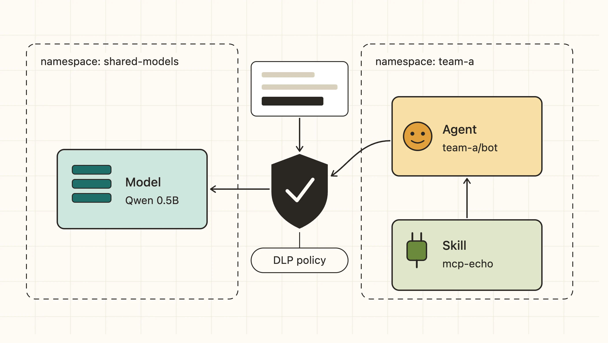
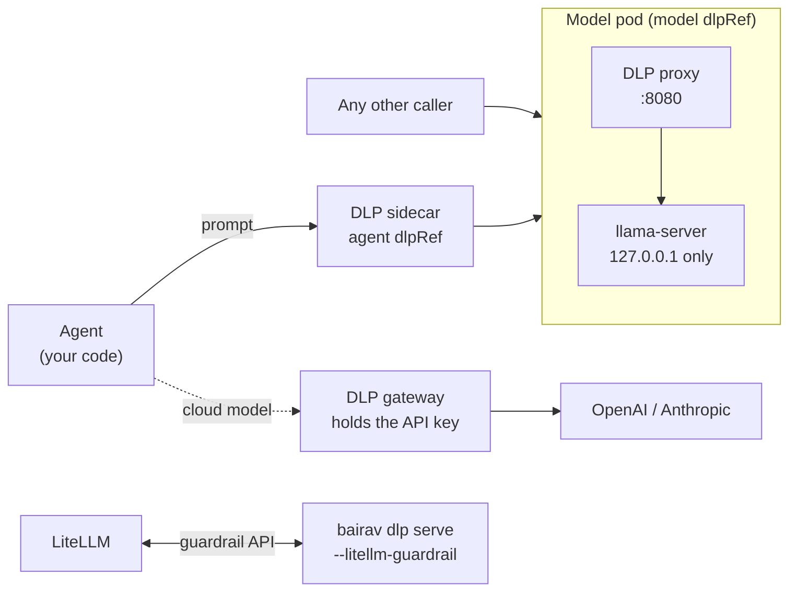

# BAIRAVS Orch Engine

**Run models, MCP tools and agents on Kubernetes or your laptop, with data-loss protection built in.**

<p align="center">
  
</p>

<p align="center">
  <a href="https://tech.bairavs.com/orch-engine/demo/"><b>Watch the dashboard demo</b></a> ·
  <a href="https://tech.bairavs.com/orch-engine/docs/">Docs</a> ·
  <a href="docs/how-dlp-works.md">How DLP works</a> ·
  <a href="https://tech.bairavs.com/">Website</a>
</p>

Orch Engine treats a model, the MCP tools it can call (skills), and the agents that use them as one connected graph. You deploy each with one command, on Docker or Kubernetes. Every prompt that leaves an agent can pass through a DLP proxy that redacts or blocks personal data and secrets before a model, local or cloud, ever sees it.

```bash
bairav model deploy Qwen/Qwen2.5-0.5B-Instruct-GGUF --name qwen      # an open-weight model, served locally
bairav skill deploy ghcr.io/bairav-foundation/mcp-echo:latest --name echo   # an MCP server
bairav agent deploy ghcr.io/you/support-agent:v1 --model qwen --skill echo --dlp
bairav ps                                                             # the graph, live
```

Same commands with `--target k8s`, where each one becomes a Kubernetes custom resource (`Model`, `Skill`, `Agent`, `DLPPolicy`, `AccessGrant`) reconciled by the operator.

## How it fits together

<p align="center"></p>

Every model call passes a DLP check, wherever you put it:



- **Next to the agent:** a sidecar per model the agent uses (`dlpRef` on the Agent).
- **Inside the model pod:** the proxy owns the Service port and the model only listens on loopback, so nothing reaches it unchecked (`dlpRef` on the Model, or `bairav model deploy --dlp-ref`).
- **In front of a cloud provider:** the gateway holds the key, pins the model and scans both ways.
- **Inside LiteLLM:** if your traffic already goes through LiteLLM, add the DLP engine as a guardrail. See [the guide](docs/quickstart-litellm.md).

## Why

- **One graph, not five tools.** Models, MCP servers and agents are wired by name. Agents get their endpoints injected, see dependencies as they come up, and are flagged when one goes away.
- **Local and cloud models, one contract.** Serve a GGUF from Hugging Face, or put `--provider openai | anthropic | openai-compatible` in front of a hosted model. Agents call the same in-cluster endpoint either way, and `bairav model upgrade` swaps between them with a smoke test and automatic rollback.
- **DLP in the data path, not on a dashboard.** The proxy inspects every string in the request (messages, tool definitions, tool results, metadata) and the response, including streams. It catches:
    - cards, SSNs, emails, phone numbers
    - checksum-validated national IDs with context rules (Aadhaar, UK NHS)
    - 12 kinds of credentials (OpenAI, Anthropic, GitHub, Slack, Stripe, Google, Hugging Face, AWS, Azure, JWT, private keys)

    It fails closed on anything it can't parse.
- **Self-hosted, Apache-2.0.** Nothing leaves your machine or cluster unless you point a model at a provider.

## Install

CLI (macOS, Linux; checks the release checksum):

```bash
curl -fsSL https://bairavs.com/install.sh | sh
```

Operator and CRDs, for `--target k8s`:

```bash
kubectl apply -f https://github.com/bairav-foundation/orch-engine/releases/latest/download/install.yaml
```

The default Docker target needs only Docker. Release binaries pull the matching images from `ghcr.io/bairav-foundation`. Prebuilt binaries start with v0.2.0; Homebrew is planned.

Build from source instead (Go 1.22+): `make rebuild-all`, then use `bin/bairav`. Source builds use locally built `bairav/*:laptop` images.

## Quickstarts

| Goal | Doc |
|------|-----|
| Deploy a model (docker, k8s, bare process) | [docs/quickstart-model.md](docs/quickstart-model.md) |
| Model + MCP skill + agent as one graph | [docs/quickstart-docker-graph.md](docs/quickstart-docker-graph.md) |
| Cloud models behind the DLP gateway | [docs/quickstart-cloud-models.md](docs/quickstart-cloud-models.md) |
| Swap models safely | [docs/quickstart-model-upgrade.md](docs/quickstart-model-upgrade.md) |
| DLP: detectors, policies, packs | [docs/quickstart-dlp.md](docs/quickstart-dlp.md) |
| DLP on an agent in Kubernetes | [docs/quickstart-dlp-on-agent.md](docs/quickstart-dlp-on-agent.md) |
| DLP as a LiteLLM guardrail | [docs/quickstart-litellm.md](docs/quickstart-litellm.md) |
| Cross-namespace access (AccessGrant) | [docs/quickstart-cross-namespace.md](docs/quickstart-cross-namespace.md) |
| The dashboard | [docs/quickstart-dashboard.md](docs/quickstart-dashboard.md) |
| Kubernetes setup | [docs/quickstart-k8s.md](docs/quickstart-k8s.md) |

Architecture: [docs/ARCHITECTURE.md](docs/ARCHITECTURE.md). How this was built: [HISTORY.md](HISTORY.md).

## Status

Alpha (`v1alpha1` CRDs). Known limits today:
- CPU serving via llama.cpp; for GPU, put a vLLM, KServe or Ollama endpoint behind `--provider openai-compatible`
- DLP is pattern-based: no names or addresses yet
- No Helm chart yet

Issues and ideas are very welcome.

## Contributing and security

See [CONTRIBUTING.md](CONTRIBUTING.md). Report vulnerabilities privately as described in [SECURITY.md](SECURITY.md).

## License

Apache-2.0. "BAIRAVS" and "Orch Engine" are names of the BAIRAV Foundation; the license does not grant rights to them.
